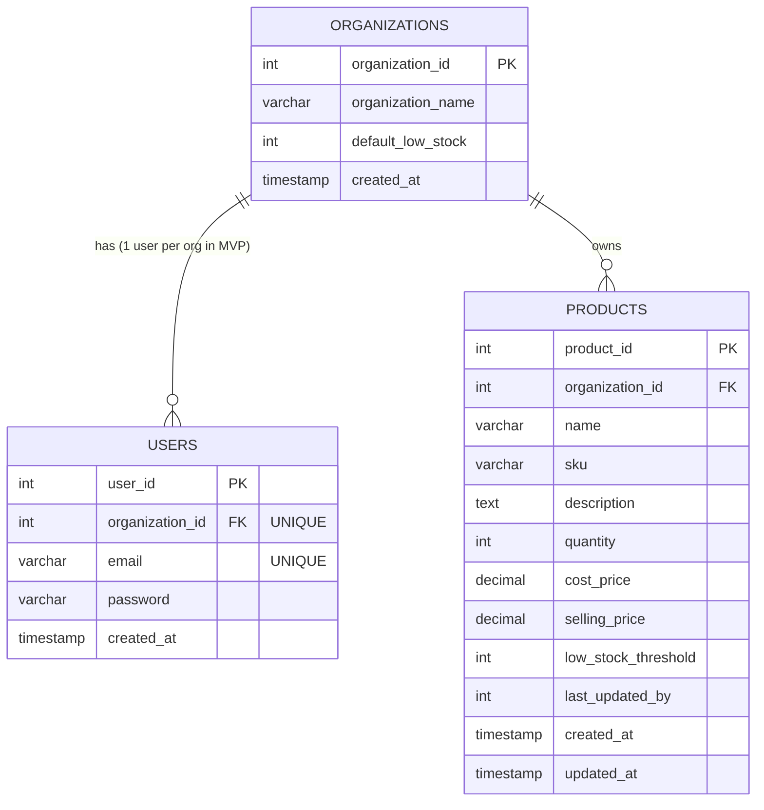

# StockFlow – SaaS Inventory Management System

[](https://stockflow-mvp.vercel.app)
[](https://stockflow-backend.onrender.com/api/health)
[](https://opensource.org/licenses/ISC)

> **StockFlow** is a modern, responsive, multi-tenant Software-as-a-Service (SaaS) inventory management web application built for small business owners and retail sellers. Designed for high reliability, data isolation, and intuitive stock control.

---

## 🚀 Key Features

- **Multi-Tenancy & Data Isolation**:
  - Strict tenant boundary enforced at the database and JWT authentication layer.
  - Every product, dashboard calculation, and setting is scoped strictly to the authenticated organization.
  - Zero cross-organization data leakage.

- **Authentication & Tenant Provisioning**:
  - Secure registration with database ACID transaction creating both organization profile and owner account.
  - Industry-standard bcrypt password hashing (10 salt rounds).
  - Stateless JSON Web Token (JWT) session management.

- **Product & Catalog Management (Full CRUD)**:
  - Add, edit, search, and delete products.
  - Enforce organization-unique Stock Keeping Units (SKU).
  - Real-time search across product names and SKUs.
  - Non-negative stock quantity and price validation.

- **Fast Stock Adjustment**:
  - Quick unit increments and decrements directly from the product table and dashboard alerts.
  - Automatic safeguards preventing inventory quantities from falling below zero.
  - Reason notes and audit tracking (`last_updated_by`).

- **Real-Time Inventory Dashboard**:
  - Live metric summary: Total Products, Total Stock Units, Low-Stock Alert Items, and Total Inventory Value.
  - Dynamic low-stock warning table displaying items where `quantity <= effective_threshold`.
  - Calculations computed on actual database queries without client-side mock data.

- **Configurable Default Thresholds**:
  - Organizations can configure a default low-stock threshold.
  - Products inherit the organization default whenever an individual custom threshold is omitted (`NULL`).

---

## 🛠️ Mandatory Tech Stack

| Layer | Technology | Details |
|---|---|---|
| **Frontend** | React 18, Vite | High performance Single Page Application |
| **Styling** | Tailwind CSS | Clean SaaS dashboard, dark slate sidebar, responsive |
| **Icons** | Lucide React | Modern, consistent iconography |
| **Routing** | React Router DOM v6 | Protected routes, layout management, SPA rewrites |
| **HTTP Client** | Axios | Centralized interceptors, bearer token management |
| **Backend** | Node.js, Express.js | Modular RESTful API architecture |
| **Security** | JWT, bcryptjs, CORS | Multi-tenancy guard, strict CORS configuration |
| **Database** | MySQL 8.0 / TiDB Cloud | Relational database, foreign keys, ACID transactions |
| **Driver** | `mysql2/promise` | Connection pooling, parameterized queries, SSL support |
| **Deployments** | Vercel & Render | Production-grade hosting with continuous deployment |

---

## 📂 Project Structure

```
StockFlow/
│
├── frontend/                     # React 18 + Vite + Tailwind CSS
│   ├── public/
│   │   └── favicon.svg           # Application logo icon
│   ├── src/
│   │   ├── components/           # UI components (Modals, Toast, Navbar, Sidebar)
│   │   │   ├── AdjustStockModal.jsx
│   │   │   ├── DeleteConfirmModal.jsx
│   │   │   ├── Navbar.jsx
│   │   │   ├── ProductModal.jsx
│   │   │   ├── Sidebar.jsx
│   │   │   └── Toast.jsx
│   │   ├── context/              # Authentication context & state
│   │   │   └── AuthContext.jsx
│   │   ├── layouts/              # Dashboard sidebar + navbar shell
│   │   │   └── DashboardLayout.jsx
│   │   ├── pages/                # Application views
│   │   │   ├── Dashboard.jsx
│   │   │   ├── Login.jsx
│   │   │   ├── Products.jsx
│   │   │   ├── Settings.jsx
│   │   │   └── Signup.jsx
│   │   ├── services/             # Axios API client with interceptors
│   │   │   └── api.js
│   │   ├── App.jsx               # Protected & public routing
│   │   ├── index.css             # Tailwind base and custom scrollbars
│   │   └── main.jsx
│   ├── index.html
│   ├── package.json
│   ├── postcss.config.js
│   ├── tailwind.config.js
│   ├── vercel.json               # SPA routing rewrite rule
│   └── vite.config.js
│
├── backend/                      # Node.js + Express.js + MySQL
│   ├── config/
│   │   └── db.js                 # MySQL pool, SSL configuration, ping check
│   ├── controllers/              # REST controllers
│   │   ├── authController.js     # Signup transaction, login, /me
│   │   ├── dashboardController.js# Summary counts, low-stock query
│   │   ├── productController.js  # CRUD, search, stock adjustment
│   │   └── settingsController.js # Organization settings
│   ├── database/
│   │   ├── migrate.js            # Auto-migration schema runner
│   │   └── seed.js               # Demonstration dataset seeder
│   ├── middleware/
│   │   ├── auth.js               # JWT bearer verification & tenant binding
│   │   └── errorHandler.js       # Centralized error handler
│   ├── routes/
│   │   ├── authRoutes.js
│   │   ├── dashboardRoutes.js
│   │   ├── productRoutes.js
│   │   └── settingsRoutes.js
│   ├── database.sql              # Raw MySQL schema definitions
│   ├── package.json
│   ├── server.js                 # Express server bootstrap & health check
│   ├── test-e2e.js               # 27-point automated verification test suite
│   └── .env.example
│
├── package.json                  # Root runner scripts
├── README.md                     # Comprehensive documentation
├── DEPLOYMENT.md                 # Deployment & cloud operations guide
└── .gitignore                    # Git exclusions
```

---

## 🗄️ Database Design



### Constraints & Integrity
1. **Multi-Tenancy**: `products.organization_id` references `organizations.organization_id` with `ON DELETE CASCADE`.
2. **SKU Uniqueness**: `UNIQUE KEY unique_org_sku (organization_id, sku)`. Different organizations can use the same SKU; an individual organization cannot have duplicate SKUs.
3. **Quantity Integrity**: `CHECK (quantity >= 0)`.
4. **MVP User Limitation**: `UNIQUE KEY unique_user_organization (organization_id)` restricts MVP accounts to one owner per tenant.

---

## 🎯 Demonstration Account & Verification Data

A seed script is included to quickly initialize the official technical recruitment test scenario:

- **Organization**: `ABC Supermarket`
- **Demo Email**: `demo@stockflow.com`
- **Demo Password**: `DemoPassword123!`

### Sample Products Initialized

| Product Name | SKU | Quantity | Cost Price | Selling Price | Threshold | Status |
|---|---|---|---|---|---|---|
| **Rice** | `RICE001` | 50 | $40.00 | $50.00 | 5 | In Stock |
| **Sugar** | `SUGAR001` | 4 | $35.00 | $45.00 | 5 | **Low Stock** (4 &le; 5) |
| **Oil** | `OIL001` | 2 | $100.00 | $120.00 | 5 | **Low Stock** (2 &le; 5) |
| **Biscuits** | `BISC001` | 30 | $10.00 | $15.00 | 5 | In Stock |

### Expected Dashboard Summary
- **Total Products**: `4`
- **Total Stock Quantity**: `86`
- **Low Stock Products**: `2` (Sugar and Oil)

*(Note: The login page includes a single-click "Fill Demo" shortcut to immediately populate these credentials without manual typing).*

---

## ⚡ Local Development Setup

### Prerequisites
- Node.js v18+ (tested on Node v22.18.0)
- npm v9+
- MySQL Server 8.0+ or compatible database

### 1. Clone the Official Repository
```bash
git clone https://github.com/chintalapatikarthik/StockFlow.git
cd StockFlow
```

### 2. Configure Backend Environment
Create `backend/.env` (using `backend/.env.example` as a template):
```env
NODE_ENV=development
PORT=5000
DB_HOST=127.0.0.1
DB_PORT=3306
DB_USER=root
DB_PASSWORD=your_password
DB_NAME=stockflow
DB_SSL=false
JWT_SECRET=stockflow_super_secret_jwt_key_2026_mvp_secure
FRONTEND_URL=http://localhost:5173
```

### 3. Install Dependencies & Seed Database
```bash
# Install backend dependencies
cd backend
npm install

# Initialize database schema & seed demo data
npm run seed

# Start backend server
npm start
```
The backend starts at `http://localhost:5000`.

### 4. Configure & Start Frontend
```bash
# In a new terminal window
cd frontend
npm install

# Start Vite dev server
npm run dev
```
Open [http://localhost:5173](http://localhost:5173) in your browser.

---

## 🧪 Automated End-to-End Verification

StockFlow includes a comprehensive 27-assertion integration test suite located at `backend/test-e2e.js`:

```bash
cd backend
node test-e2e.js
```

### Test Results
```text
====================================================
StockFlow Comprehensive E2E Verification Test Suite
====================================================

[PASS] 1. System Health Check & MySQL connectivity
[PASS] 2. Login with valid credentials
[PASS] 3. Invalid password rejection (401 Unauthorized)
[PASS] 4. Duplicate email rejection (409 Conflict)
[PASS] 5. Verified authentication context (GET /auth/me)
[PASS] 6. Dashboard product count matches seed data (4)
[PASS] 7. Dashboard total stock quantity matches seed data (86)
[PASS] 8. Dashboard low stock count matches seed data (2: Sugar & Oil)
[PASS] 9. Correct low stock items identified (Oil & Sugar)
[PASS] 10. Product creation with custom threshold (FLOUR001)
[PASS] 11. Duplicate SKU rejection per organization (409 Conflict)
[PASS] 12. Negative quantity rejection during product creation (400 Bad Request)
[PASS] 13. Product search by name/SKU
[PASS] 14. Product editing (fields & prices updated)
[PASS] 15. Stock adjustment: decrement 14 - 10 = 4
[PASS] 16. Negative stock adjustment prevention (400 Bad Request)
[PASS] 17. Dynamic low stock detection triggered when quantity falls below threshold
[PASS] 18. Item automatically leaves low stock alert when stock is restored
[PASS] 19. Product deletion (hard delete with confirmation)
[PASS] 20. Retrieve organization default threshold (5)
[PASS] 21. Product without custom threshold is healthy when qty (10) > org default (5)
[PASS] 22. Update organization default low stock threshold to 15
[PASS] 23. Product with NULL threshold inherits new org default (15) and triggers low-stock warning
[PASS] 24. Strict Tenancy Isolation: Tenant 2 starts with 0 products
[PASS] 25. Strict Tenancy Isolation: Tenant 2 dashboard has 0 products & 0 stock
[PASS] 26. Cross-tenant product access strictly blocked (404 Not Found)
[PASS] 27. Cross-tenant product deletion strictly blocked (404 Not Found)

====================================================
Summary: 27 Passed, 0 Failed
====================================================
```

---

## 🌐 Production Deployment

Refer to [`DEPLOYMENT.md`](./DEPLOYMENT.md) for full cloud configuration steps for **TiDB Cloud (Database)**, **Render (Backend API)**, and **Vercel (Frontend React SPA)**.
